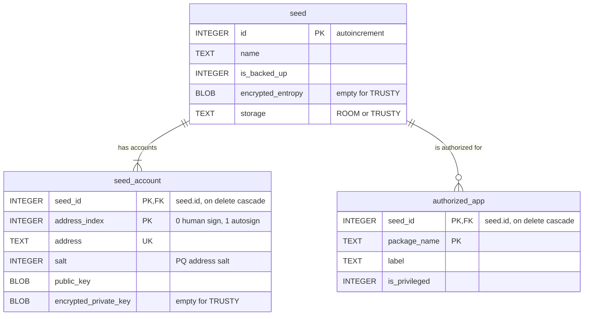

# seed-vault-service
Companion Android service for the Seed Vault Trusty applet.

## Modules

- **seed-vault-service**: Android Seed Vault app in the Solana Seed Vault style (settings, seed details, authorized apps). Generates and imports 25-word Falcon-1024 seed phrases, stores them in Room (encrypted with a StrongBox/TEE Android Keystore key that needs a fresh fingerprint or screen lock to use, or kept in the Trusty applet when available) and exposes a bound AIDL service to authorized apps.
- **seed-vault-sdk**: UI-free Android client library for the Falcon-1024 Seed Vault service and the Solana Mobile Seed Vault, including AIDL, account access, networking and payment flows.
- **seed-vault-demo-app**: Sample wallet that consumes `seed-vault-sdk` for its Algorand and Solana tabs.

## Embedded libraries

These are checked in as local `.aar` files in `seed-vault-service/libs/` and referenced with `implementation(files("libs/..."))`:

- **`algokit_seed_vault.aar`**: client for the Trusty applet (Falcon-1024 keys in the TEE).
- **`algokit_crypto.aar`**, **`algokit_transact.aar`**, **`algokit_composer.aar`**: algokit-core Rust FFI. Falcon-1024 seed phrases, keys and addresses, and signing and encoding Algorand transactions.
- **`wallet_sdk_core.aar`**: `wallet-sdk-core` from `algokit-walletsdk-kmp` (Keystore encryption, MVI base classes).

## Database

`seed-vault-service` keeps its metadata in Room (`seed_vault.db`, schema version 1, exported to `seed-vault-service/schemas/`). Secrets are only in the database when the seed's `storage` is `ROOM`; for `TRUSTY` they stay in the TEE and the encrypted columns (`seed.encrypted_entropy`, `seed_account.encrypted_private_key`) are empty.

`seed` holds the seed phrase entropy; each account in `seed_account` holds its own Falcon-1024 key pair, address and PQ address salt. Every seed has two accounts: index 0 is the human sign account (each signature needs the user's approval), index 1 is the autosign account (signs without a prompt while autosign is on in Security). Today both accounts of a seed hold the same key pair and differ only by salt, but keeping the keys per account lets an account have its own key later. Deleting a seed cascades to its accounts and authorized apps.



## Build and test

```
./gradlew :seed-vault-service:ktlintFormat
./gradlew :seed-vault-service:testDebugUnitTest :seed-vault-service:ktlintCheck :seed-vault-service:assembleDebug :seed-vault-demo-app:assembleDebug
```

Install `seed-vault-service` before `seed-vault-demo-app` so the permission exists when the client is installed. After a package rename or a Room schema change, uninstall the app first: the database has no migrations yet.

